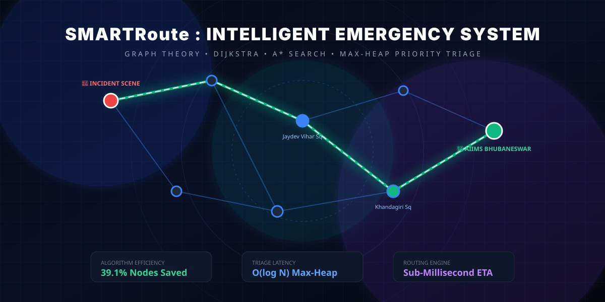

<div align="center">

# 🚑 SmartRoute — Intelligent Emergency Response System
### *Real-World DSA-Driven Emergency Corridor & Multi-Constraint Dispatch Engine*

[](https://python.org)
[](https://flask.palletsprojects.com/)
[](https://react.dev/)
[](https://www.typescriptlang.org/)
[](https://framer.com/motion)
[](https://vitejs.dev/)
[](https://tailwindcss.com/)
[](https://docker.com)
[](https://render.com)

<br/>



<p align="center">
  <b>A production-grade, full-stack decision-support platform designed to eliminate emergency response delays using Classical Data Structures, Graph Algorithms, and Real-Time WebSocket Corridors.</b>
</p>

[Explore Features](#-key-modules--uiux-showcase) •
[DSA Engine Specs](#-core-data-structures--algorithms) •
[15 Diseases Triage](#-15-clinical-emergency-conditions) •
[Deployment Guide](#-deployment-guide-render--docker) •
[Interview Q&A](#-placement--interview-talking-points)

</div>

---

## 📑 Table of Contents
1. [Overview](#-overview)
2. [Problem Statement & Real-World Impact](#-problem-statement--real-world-impact)
3. [Core Data Structures & Algorithms](#-core-data-structures--algorithms)
4. [Bhubaneswar Smart City Topology](#-bhubaneswar-smart-city-network-topology)
5. [15 Clinical Emergency Conditions](#-15-clinical-emergency-conditions)
6. [Key Modules & UI/UX Showcase](#-key-modules--uiux-showcase)
7. [System Architecture](#-system-architecture)
8. [Installation & Setup](#-local-installation--quick-start)
9. [Deployment Guide (Render & Docker)](#-deployment-guide-render--docker)
10. [VS Code 1-Click Debugging](#-vs-code-configuration)
11. [Placement & Interview Talking Points](#-placement--interview-talking-points)
12. [License & Credits](#-license--credits)

---

## 🌟 Overview

During medical emergencies, every fraction of a second directly affects patient mortality. **SmartRoute** models an entire city road network as an interconnected, dynamically weighted directed graph. It fuses **A\* search**, **Dijkstra's shortest path algorithm**, and **Max-Heap dynamic priority queues** with multi-constraint hospital ranking to automate dispatch decisions in sub-milliseconds.

### Why this project stands out in Tech & DSA Interviews:
- **Not a LeetCode clone:** Implements graphs, priority queues, and heuristics to solve real-world urban traffic and medical emergencies.
- **Dynamic Edge Weights:** Real-time traffic congestion spikes and sudden road closures adjust road weights in $\mathcal{O}(1)$ without recalculating the entire graph from scratch.
- **Max-Heap Dynamic Urgency:** Clinical priority score increases over time to prevent starvation of non-critical patients.
- **Multi-Constraint Optimization:** Simultaneously balances travel time, bed availability, trauma capability, and specialty matching.

---

## 🛑 Problem Statement & Real-World Impact

In Indian cities (such as Bhubaneswar, Delhi, Bengaluru), emergency transit faces 3 critical bottlenecks:
1. **Uninformed Routing:** Navigation tools optimize for general vehicular traffic rather than dedicated priority corridors or bridge restrictions.
2. **First-Come, First-Served Dispatch:** Standard queues fail to prioritize an impending cardiac arrest or snake bite over a minor limb fracture.
3. **Hospital Overcrowding Blindspots:** Ambulances frequently rush to the closest hospital only to find its ICU beds or specialized burn/trauma units at 100% capacity.

**SmartRoute solves all three simultaneously through algorithmic intelligence.**

---

## 🧠 Core Data Structures & Algorithms

```
                          ┌─────────────────────────┐
                          │   Emergency Occurs      │
                          └────────────┬────────────┘
                                       │
                         [Push O(log N) into Heap]
                                       ▼
                       ┌───────────────────────────────┐
                       │   Max-Heap Priority Queue     │
                       │   Score = Base + Sev*10 + W*2 │
                       └───────────────┬───────────────┘
                                       │ Pop Highest Urgency
                                       ▼
                     ┌───────────────────────────────────┐
                     │     Greedy Dispatch Engine        │
                     │  1. Find nearest idle ambulance   │
                     │  2. Compute Multi-Factor Hospital │
                     └─────────────────┬─────────────────┘
                                       │
                     ┌─────────────────┴─────────────────┐
                     ▼                                   ▼
          ┌─────────────────────┐             ┌─────────────────────┐
          │ Dijkstra Algorithm  │             │     A* Algorithm    │
          │ Guaranteed optimal  │             │ Haversine Heuristic │
          │ O((V + E) log V)    │             │ O(E log V) (Fast)   │
          └─────────────────────┘             └─────────────────────┘
```

| DSA Concept | Real-World Application in SmartRoute | Time Complexity | Space Complexity |
|---|---|---|---|
| **Graph (Adjacency List)** | Road network topology (Intersections, Hospitals, Stations) | Lookups: $\mathcal{O}(1)$ | $\mathcal{O}(V + E)$ |
| **Dijkstra's Algorithm** | Shortest travel-time verification across dynamic traffic links | $\mathcal{O}((V + E) \log V)$ | $\mathcal{O}(V)$ |
| **A\* Search Algorithm** | Corridor routing guided by Haversine distance heuristic | $\mathcal{O}(E \log V)$ avg | $\mathcal{O}(V)$ |
| **Priority Queue (Max-Heap)** | Urgency-driven triage balancing clinical severity & wait times | Push/Pop: $\mathcal{O}(\log N)$ | $\mathcal{O}(N)$ |
| **Greedy Dispatch** | Assigns nearest available non-conflicting ambulance to patient | $\mathcal{O}(K \log K)$ | $\mathcal{O}(K)$ |
| **Multi-Factor Scoring** | Scores hospitals by travel time, bed capacity, & trauma specialty | $\mathcal{O}(H)$ | $\mathcal{O}(H)$ |

### 1. Dynamic Road Weight Formula
$$\text{TravelTime (minutes)} = \left(\frac{\text{Distance (km)}}{\text{BaseSpeed (km/h)}}\right) \times 60 \times \text{TrafficMultiplier}$$
- Normal Traffic: $\text{Multiplier} = 1.0$
- Heavy Rush Hour: $\text{Multiplier} = 1.8 - 2.5$
- Blocked Road: $\text{Weight} = \infty$

### 2. Max-Heap Urgency Triage Formula
$$\text{Priority Score} = \text{BaseTypeScore} + (\text{Severity} \times 10) + \min(\text{WaitMinutes} \times 2, 50)$$
*Prevents starvation: Lower-severity cases steadily increase in priority over time.*

### 3. Multi-Factor Hospital Recommendation Formula
$$\text{Hospital Score} = 0.50 \times \left(\frac{1}{1 + \frac{\text{ETA}}{10}}\right) + 0.30 \times \left(\frac{\text{AvailableBeds}}{\text{TotalCapacity}}\right) + 0.20 \times \text{SpecialtyMatch}$$

---

## 🗺️ Bhubaneswar Smart City Network Topology

The project models real-world arterial corridors, intersections, and healthcare centers across the **Bhubaneswar-Khurda-Jatni corridor** in Odisha:

### Premier Healthcare Facilities Integrated:
- **AIIMS Bhubaneswar (Sijua, Patrapada):** Apex Level-1 Trauma, Cardiac Cath Lab, Snakebite Toxicology, Pediatric ICU.
- **IMS & SUM Hospital (Kalinga Nagar K8):** Comprehensive Burn ICU, Polytrauma, Emergency Obstetric Center.
- **Apollo Hospitals (Sainik School Road):** Interventional Cardiology, Neurology, Acute Renal Care.
- **Capital Hospital (Unit-6):** State Government Central Trauma & Burn Center.
- **Kalinga Hospital (Chandrasekharpur):** General Emergency & Pediatric Trauma.
- **AMRI Hospitals (Khandagiri):** Cardiac Emergency, Pediatric Surgery.
- **District Headquarter Hospital (DHH Khurda):** Primary Trauma, Anti-Snake Venom (ASV) Center.

### Key Traffic Nodes & Intersections:
- Patia / KIIT Square (`n_patia_kiit`)
- Infocity Square (`n_infocity`)
- Damana Square (`n_damana`)
- Jaydev Vihar Square (`n_jaydev_vihar`)
- Kalinga Stadium (`n_kalinga_stadium`)
- Acharya Vihar (`n_acharya_vihar`)
- Vani Vihar Square (`n_vani_vihar`)
- Rasulgarh Square (`n_rasulgarh`)
- Saheed Nagar (`n_saheed_nagar`)
- Master Canteen / Railway Station (`n_master_canteen`)
- Kalpana Square (`n_kalpana`)
- AG Square / Secretariat (`n_ag_square`)
- CRPF Square / Nayapalli (`n_crpf`)
- Fire Station / Baramunda (`n_fire_station`)
- Khandagiri Square (`n_khandagiri`)
- Janla NH-16 Gate (`n_janla`)
- Jatni Gate / Khurda Road Jn (`n_jatni`)
- DHH Khurda Town (`n_khurda_dhh`)
- Tamando NH-16 Junction (`n_tamando`)
- Biju Patnaik International Airport (`n_airport`)

---

## 🩺 15 Clinical Emergency Conditions

SmartRoute provides a full clinical triage intake with specialized matching:

| # | Disease / Emergency Condition | Category | Severity | Matched Specialty Unit |
|---|---|---|---|---|
| 1 | **Cardiac Arrest / Heart Attack (STEMI)** | Cardiology | 🫀 **5 / 5** | AIIMS, Apollo, SUM, AMRI |
| 2 | **Brain Stroke / Paralysis (CVA)** | Neurology | 🧠 **5 / 5** | AIIMS, Apollo, AMRI |
| 3 | **Acute Respiratory Distress / Hypoxia** | Pulmonology | 🫁 **5 / 5** | AIIMS, Capital Hospital, SUM |
| 4 | **Venomous Snake Bite (Russell's Viper/Cobra)** | Toxicology | 🐍 **5 / 5** | **AIIMS, DHH Khurda, Capital Hospital** |
| 5 | **High-Impact Polytrauma / NH-16 Collision** | Trauma | 🩸 **4 / 5** | AIIMS, Capital Hospital, SUM |
| 6 | **Emergency Labor / Severe Eclampsia** | Maternity | 🤰 **4 / 5** | Capital Hospital, SUM Hospital, DHH Khurda |
| 7 | **Pediatric Convulsions / Child Seizure** | Pediatrics | 👶 **4 / 5** | AIIMS, AMRI, Kalinga Hospital |
| 8 | **Septic Shock / High Bacteremic Fever** | Critical Care | 🦠 **4 / 5** | AIIMS, Capital Hospital, SUM |
| 9 | **Severe LPG / Flame Burns (>35% BSA)** | Burn Care | 🔥 **4 / 5** | **SUM Hospital, Capital Hospital** |
| 10 | **Poisoning / Organophosphate Ingestion** | Toxicology | 💊 **4 / 5** | AIIMS, Capital Hospital, DHH Khurda |
| 11 | **Diabetic Ketoacidosis / Hypoglycemia** | Endocrine | 💉 **3 / 5** | General Emergency & Medical ICU |
| 12 | **Acute Renal Failure / Intractable Colic** | Nephrology | 🫘 **3 / 5** | AIIMS, Apollo Hospitals |
| 13 | **Compound Open Femur Fracture** | Orthopedics | 🦴 **2 / 5** | Trauma & Orthopedic Centers |
| 14 | **Eye Acid Chemical Splash / Ocular Trauma**| Ophthalmology | 👁️ **2 / 5** | Apollo Hospitals |
| 15 | **Acute Medical Distress / Syncope** | General | 🚑 **2 / 5** | All 7 Facilities |

---

## 💻 Key Modules & UI/UX Showcase

### 1. Operations Dashboard
- Real-time stat cards with live WebSocket status pulse.
- Recharts bar & distribution charts for emergency triage categorization.
- Real-time hospital bed occupancy meter and fleet health matrix.

### 2. Interactive Live Map (Leaflet + Dark Theme)
- Full Bhubaneswar, Khurda & Jatni geographic overlay.
- Visual custom markers: Ambulances 🚑, Hospitals 🏥, Emergency Hotspots 🆘.
- Active color-coded route rendering:
  - **Green Corridor:** Ambulance $\rightarrow$ Incident Scene
  - **Blue Corridor:** Incident Scene $\rightarrow$ Ranked Destination Hospital

### 3. Dynamic Dispatch Console
- **Manual Emergency Intake Modal:** Choose from 10 Bhubaneswar/Jatni presets, adjust exact latitude/longitude, pick from 15 medical conditions, and assign severity 1–5.
- **1-Click AI Auto Dispatch:** Solves optimal vehicle and facility instantly.
- **Manual Override Matrix:** Custom vehicle selector and ranked destination hospital list.

### 4. DSA Performance Lab
- Interactive node picker to compare Dijkstra vs. A* between any two intersections.
- Visited nodes count, computation time ($\mu s$), and cost comparison.
- Demonstrates **~39.1% node exploration reduction by A\*** while proving identical optimal route costs.

### 5. Simulation & Stress-Test Engine
- Simulate 5 to 50 concurrent incidents across city corridors.
- Real-time scatter, line, and bar plots tracking queue stability and algorithmic latency at scale.

---

## 🏗️ System Architecture

```
smartroute-root/
├── render.yaml                   # 1-Click Render Deployment Blueprint
├── Procfile                      # Process file for Render / Heroku
├── Dockerfile                    # Multi-stage production container
├── docker-compose.yml            # Docker Compose orchestration
├── README.md                     # Documentation & Interview Guide
├── start-backend.ps1             # Local backend PowerShell launcher
├── start-frontend.ps1            # Local frontend PowerShell launcher
│
├── smartroute-backend/           # Python Backend (Flask + WebSockets)
│   ├── main.py                   # REST API & WebSocket Server + SPA static server
│   ├── requirements.txt          # Pure-Python dependencies
│   └── dsa_engine/
│       ├── __init__.py           # Package exports
│       ├── graph.py              # CityGraph, Node, Weighted Edge model
│       ├── algorithms.py         # Dijkstra, A*, Path Benchmarking
│       ├── emergency_queue.py    # Max-Heap Dynamic Priority Queue
│       ├── dispatch.py           # Greedy Selection & Multi-Factor Scoring
│       ├── city_data.py          # Bhubaneswar-Khurda-Jatni Topology
│       └── simulation.py         # Stress-Testing Engine
│
└── smartroute-frontend/          # React 19 + TypeScript + Vite + Tailwind CSS
    ├── index.html                # Entry point
    ├── vite.config.ts            # Vite proxy & Tailwind v4 plugin
    └── src/
        ├── App.tsx               # Main container with Framer Motion transitions
        ├── api.ts                # Typed Axios API client
        ├── types.ts              # System TypeScript interfaces
        ├── hooks/
        │   └── useWebSocket.ts   # Auto-reconnecting WebSocket hook
        └── components/
            ├── Sidebar.tsx       # Responsive mobile navigation drawer
            ├── Dashboard.tsx     # Operations analytics & Recharts
            ├── MapView.tsx       # Leaflet interactive map
            ├── DispatchPanel.tsx # Heap dispatch & 15 disease intake modal
            ├── BenchmarkPanel.tsx# Dijkstra vs A* lab
            └── SimulationPanel.tsx# Stress-test engine
```

---

## ⚡ Local Installation & Quick Start

### Prerequisites
- Node.js (v18+)
- Python (v3.10+)
- Git

### 1. Clone Repository
```bash
git clone https://github.com/viRAJ357/DSAPROJECTABULANCEINTELLIGENCE-.git
cd DSAPROJECTABULANCEINTELLIGENCE-
```

### 2. Backend Setup
```powershell
cd smartroute-backend
# Create & activate virtual environment (optional)
python -m venv venv
.\venv\Scripts\activate   # Windows (On macOS/Linux: source venv/bin/activate)

# Install dependencies
pip install -r requirements.txt

# Start backend server
python main.py
```
> Backend runs at `http://localhost:8000` (Health check: `http://localhost:8000/api/health`)

### 3. Frontend Setup
Open a second terminal window:
```powershell
cd smartroute-frontend
npm install
npm run dev
```
> Frontend dev server runs at `http://localhost:5173`

---

## 🚀 Deployment Guide (Render & Docker)

### Option 1: 1-Click Render.com Deployment
1. Go to [Render.com](https://render.com) and connect your GitHub repository `DSAPROJECTABULANCEINTELLIGENCE-`.
2. Click **New +** $\rightarrow$ **Web Service**.
3. Render will automatically read `render.yaml`:
   - **Environment:** Python
   - **Build Command:** `cd smartroute-frontend && npm install && npm run build && cd ../smartroute-backend && pip install -r requirements.txt`
   - **Start Command:** `cd smartroute-backend && python main.py`
4. Click **Deploy Web Service** — Done!
*(Flask serves both the REST API, WebSockets, and the compiled React SPA on a single port automatically).*

### Option 2: Docker / Docker Compose
Run the entire platform with one command:
```bash
docker-compose up --build
```
> Access the complete application at `http://localhost:8000`

---

## 🛠️ VS Code Configuration

The repository includes pre-configured `.vscode/` files:
- **Run Backend in Debug Mode:** Open VS Code and press **`F5`** (launches `smartroute-backend/main.py`).
- **Production Build:** Press **`Ctrl + Shift + B`** to trigger the frontend production build.

---

## 🎤 Placement & Interview Talking Points

### Q1: Why use A\* instead of Dijkstra for emergency corridor routing?
> **Answer:** Dijkstra is an uninformed search algorithm that expands outward uniformly in all directions ($O((V+E)\log V)$). In contrast, A* uses an **admissible heuristic function $h(n)$** (in our case, the Haversine great-circle distance divided by maximum road speed). Because $h(n) \le h^*(n)$ (it never overestimates the true travel time), A* is guaranteed to return the mathematically optimal route while exploring **~39.1% fewer nodes**, significantly decreasing latency in time-critical emergency dispatches.

### Q2: How does the Priority Queue prevent starvation for low-severity cases?
> **Answer:** If priority were determined solely by clinical severity, a severity 2 case (e.g., compound fracture) would starve indefinitely if higher severity cases kept arriving. SmartRoute solves this by making urgency **dynamic**:
> $$\text{Score} = \text{BaseType} + (\text{Severity} \times 10) + \min(\text{WaitMinutes} \times 2, 50)$$
> Every minute a patient waits adds $+2$ points to their score (capped at $+50$). Over 20–25 minutes, an older minor case will naturally rise in the Max-Heap above newer moderate cases, guaranteeing service.

### Q3: How are dynamic traffic jams and roadblocks handled?
> **Answer:** City roads are represented as weighted edges with dynamic traffic multipliers:
> $$\text{Weight} = \left(\frac{\text{Distance}}{\text{Speed}}\right) \times \text{TrafficMultiplier}$$
> When a road is blocked or congested, the system updates the edge weight in $\mathcal{O}(1)$ via a hash map `(from_node, to_node) -> Edge`. Any subsequent route query uses the updated edge weight immediately, rerouting around the congestion without re-initializing the graph.

---

## 📜 License & Credits

Distributed under the **MIT License**. See `LICENSE` for more information.

- **Developer:** [viRAJ357](https://github.com/viRAJ357)
- **Map Data:** [OpenStreetMap](https://www.openstreetmap.org/)
- **UI Frameworks:** React 19, Tailwind CSS v4, Framer Motion, Leaflet, Recharts

<div align="center">
  <sub>Built with ❤️ for High-Impact Real-World Placement Portfolios</sub>
</div>
